# buildifylabs: RepoGraph Context
> Generated 2026-10-12 by RepoGraph AI. Paste this whole file to any coding agent (Copilot, Cursor, Claude) instead of letting it re-scan the repo.


## Tech stack
- TypeScript/JavaScript (React, Vite)
- Python (FastAPI, SQLAlchemy, Alembic, Groq)

## Entry points
- `Backend/app/main.py`
- `Frontend/src/main.tsx`
- `Frontend/src/App.tsx`

## Top files (purpose + exports)
- `Frontend/src/types/index.ts`: Barrel re-export of ./api, ./auth, ./chat (used by 19 files)
- `Frontend/src/features/chat/chat-store.ts`: Shared type definitions: PendingKind, ChatConversation, UserChatMessage, AssistantChatMessage (used by 22 other files) (exports: PendingKind, ChatConversation, UserChatMessage, AssistantChatMessage, SystemNoticeKind, SystemChatMessage, ChatMessage, AssistantMessageKind)
- `Backend/app/config.py`: Defines Settings (used by 22 other files) (exports: get_settings, Settings)
- `Frontend/src/types/chat.ts`: Shared type definitions: SourceScope, VisualOutput, ClarificationRequest, WebSource (used by 20 other files) (exports: SourceScope, VisualOutput, ClarificationRequest, WebSource, PipelineOutput, ChatRequest, FlagRequest, FlagResponse)
- `Backend/app/services/llm/langchain_pipeline.py`: Compatibility re-export shim for app.services.llm.pipeline (no own logic)
- `Frontend/src/features/auth/auth-store.ts`: Shared type definitions: AuthStatus (used by 14 other files) (exports: AuthStatus, useAuthStore)
- `Backend/app/services/web_search.py`: Defines WebSearchResult, _DuckDuckGoParser (used by 11 other files) (exports: wants_historical, requested_history_years, wants_recommendation_extract, WebSearchResult, _DuckDuckGoParser)
- `Backend/app/db/models/user.py`: Defines User (used by 14 other files) (exports: User)
- `Frontend/src/features/chat/quota-store.ts`: Exports utilities: rollIfElapsed (exports: WINDOW_QUESTIONS_LIMIT, WINDOW_HOURS, LIFETIME_QUESTIONS_LIMIT, WINDOW_MS, useQuotaStore)
- `Backend/app/services/llm/pipeline/models.py`: Defines VisualOutput, ClarificationRequest, WebSource, VisualPlanItem, Decision, PipelineOutput (used by 8 other files) (exports: coerce_web_sources, default_decision, VisualOutput, ClarificationRequest, WebSource, VisualPlanItem, Decision, PipelineOutput)

## Provenance
EXTRACTED 414 · INFERRED 193 · AMBIGUOUS 0

## God nodes (change risk)
- `Frontend/src/types/index.ts`
- `Frontend/src/features/chat/chat-store.ts`
- `Backend/app/config.py`
- `Frontend/src/types/chat.ts`
- `Frontend/src/App.tsx`
- `Backend/app/services/llm/langchain_pipeline.py`
- `Backend/app/db/database.py`
- `Frontend/src/hooks/useAuth.ts`
- `Backend/app/routes/chat.py`
- `Frontend/src/features/auth/auth-store.ts`

## Key symbols (file:line)
- `Frontend/src/features/chat/chat-store.ts`: classifyAssistantOutput(function:91), messagesForConversation(function:100), PendingKind(type:28), ChatConversation(interface:30), UserChatMessage(interface:36), AssistantChatMessage(interface:50)
- `Backend/app/config.py`: get_settings(function:200), Settings(class:8)
- `Frontend/src/types/chat.ts`: SourceScope(type:7), VisualOutput(interface:9), ClarificationRequest(interface:25), WebSource(interface:30), PipelineOutput(interface:42), ChatRequest(interface:71)
- `Backend/app/db/database.py`: get_engine(function:15), get_session_maker(function:32), check_db_connection(function:36), get_db(function:43)
- `Frontend/src/hooks/useAuth.ts`: useAuth(function:20)
- `Backend/app/routes/chat.py`: chat(function:269), chat_stream(function:278), flag_answer(function:920), _Sentinel(class:333)
- `Frontend/src/features/auth/auth-store.ts`: AuthStatus(type:10)
- `Backend/app/services/web_search.py`: wants_historical(function:106), requested_history_years(function:118), wants_recommendation_extract(function:1085), WebSearchResult(class:385), _DuckDuckGoParser(class:407)
- `Frontend/src/lib/errors.ts`: getErrorMessage(function:19)
- `Backend/app/db/models/user.py`: User(class:8)
- `Frontend/src/features/chat/Composer.tsx`: Composer(function:52)
- `Frontend/src/api/files.ts`: uploadFile(function:8), listFiles(function:14), getFile(function:18), previewFile(function:22), deleteFile(function:26)
- `Frontend/src/features/chat/MessageStream.tsx`: MessageStream(function:23)
- `Frontend/src/lib/http.ts`: apiUrl(function:19), authHeaders(function:23), isQuotaError(function:43), ApiError(class:30)
- `Backend/app/services/llm/pipeline/run.py`: log_runtime_trace(function:188), run_pipeline(function:209)

## Dependencies (60 shown of 607)
`from -> to` means "from imports to".
- `Frontend/src/types/index.ts` -> `Frontend/src/types/chat.ts`
- `Frontend/src/features/chat/chat-store.ts` -> `Frontend/src/types/chat.ts` ({ PipelineOutput })
- `Frontend/src/hooks/useAuth.ts` -> `Frontend/src/types/index.ts` ({)
- `Frontend/src/features/auth/auth-store.ts` -> `Frontend/src/types/index.ts` ({ AuthResponse, AuthUserResponse, TokenResponse })
- `Frontend/src/lib/errors.ts` -> `Frontend/src/types/index.ts` ({ ApiErrorBody })
- `Frontend/src/api/files.ts` -> `Frontend/src/types/index.ts` ({ FilePreview, FileResponse })
- `Backend/app/services/llm/langchain_pipeline.py` -> `Backend/app/config.py` (get_settings  # noqa: F401)
- `Backend/app/db/database.py` -> `Backend/app/config.py` (get_settings)
- `Frontend/src/lib/http.ts` -> `Frontend/src/types/index.ts` ({ ApiErrorBody, QuotaErrorBody })
- `Backend/app/routes/chat.py` -> `Backend/app/config.py` (get_settings)
- `Frontend/src/features/chat/Composer.tsx` -> `Frontend/src/features/chat/chat-store.ts` ({ useChatStore, type PendingKind })
- `Backend/app/services/web_search.py` -> `Backend/app/config.py` (get_settings)
- `Frontend/src/features/chat/MessageStream.tsx` -> `Frontend/src/features/chat/chat-store.ts` ({ messagesForConversation, useChatStore })
- `Backend/app/services/llm/pipeline/__init__.py` -> `Backend/app/config.py` (get_settings  # noqa: F401)
- `Frontend/src/features/chat/Composer.tsx` -> `Frontend/src/types/chat.ts` ({ SourceScope })
- `Frontend/src/features/chat/AccountDialog.tsx` -> `Frontend/src/types/index.ts` ({ FileResponse })
- `Frontend/src/features/chat/Composer.test.tsx` -> `Frontend/src/types/index.ts` ({ Plan })
- `Backend/app/services/llm/pipeline/run.py` -> `Backend/app/config.py` (get_settings)
- `Frontend/src/api/chat.ts` -> `Frontend/src/types/index.ts` ({ ChatRequest, FlagRequest, FlagResponse, PipelineOutput })
- `Frontend/src/components/visuals/VisualCard.tsx` -> `Frontend/src/types/chat.ts` ({ VisualOutput })
- `Frontend/src/features/chat/Composer.test.tsx` -> `Frontend/src/features/chat/chat-store.ts` ({ useChatStore })
- `Frontend/src/features/chat/messages/ClarificationMessage.tsx` -> `Frontend/src/features/chat/chat-store.ts` ({ useChatStore })
- `Frontend/src/features/auth/auth-screens.test.tsx` -> `Frontend/src/types/index.ts` ({ AuthResponse })
- `Frontend/src/features/overview/OverviewPage.tsx` -> `Frontend/src/types/index.ts` ({ FileResponse })
- `Backend/app/main.py` -> `Backend/app/config.py` (get_settings)
- `Frontend/src/api/auth.ts` -> `Frontend/src/types/index.ts` ({)
- `Backend/app/services/llm/pipeline/guarantee.py` -> `Backend/app/config.py` (get_settings)
- `Backend/app/routes/chat.py` -> `Backend/app/db/database.py` (get_db)
- `Backend/app/routes/chat.py` -> `Backend/app/services/llm/langchain_pipeline.py` (ClarificationRequest, PipelineOutput, _same_question as _is_)
- `Frontend/src/features/chat/UploadPopover.tsx` -> `Frontend/src/types/index.ts` ({ FileResponse, FileStatus })
- `Frontend/src/features/chat/messages/AssistantAnswer.tsx` -> `Frontend/src/types/chat.ts` ({ PipelineOutput })
- `Backend/app/services/web_search.py` -> `Backend/app/services/llm/langchain_pipeline.py` (TOOL_CATALOG)
- `Backend/app/services/llm/groq_service.py` -> `Backend/app/config.py` (get_settings)
- `Frontend/src/hooks/useAuth.ts` -> `Frontend/src/features/auth/auth-store.ts` ({ useAuthStore })
- `Backend/app/db/models/user.py` -> `Backend/app/db/database.py` (Base)
- `Frontend/src/features/data/DataPage.tsx` -> `Frontend/src/types/index.ts` ({ FilePreview, FileResponse, FileStatus })
- `Frontend/src/features/chat/Composer.test.tsx` -> `Frontend/src/types/chat.ts` ({ PipelineOutput })
- `Frontend/src/features/chat/messages/ClarificationMessage.tsx` -> `Frontend/src/types/chat.ts` ({ PipelineOutput })
- `Frontend/src/features/chat/DocumentPicker.test.tsx` -> `Frontend/src/types/index.ts` ({ Plan })
- `Frontend/src/features/chat/scope-store.ts` -> `Frontend/src/types/chat.ts` ({ SourceScope })
- `Frontend/src/features/overview/OverviewPage.tsx` -> `Frontend/src/features/chat/chat-store.ts` ({ useChatStore })
- `Frontend/src/api/contact.ts` -> `Frontend/src/types/index.ts` ({ ContactForm, ContactResponse })
- `Backend/app/services/llm/langchain_pipeline.py` -> `Backend/app/services/llm/pipeline/__init__.py` (*  # noqa: F401,F403)
- `Frontend/src/types/chat.ts` -> `Frontend/src/lib/schemas/visuals.ts` ({ VisualProps, VisualType })
- `Backend/app/routes/chat.py` -> `Backend/app/db/models/user.py` (User)
- `Backend/app/routes/chat.py` -> `Backend/app/services/web_search.py` (search_web)
- `Frontend/src/features/chat/UploadPopover.tsx` -> `Frontend/src/features/chat/chat-store.ts` ({ useChatStore })
- `Frontend/src/features/chat/Composer.tsx` -> `Frontend/src/hooks/useAuth.ts` ({ useAuth })
- `Frontend/src/features/chat/EmptyThread.test.tsx` -> `Frontend/src/types/index.ts` ({ FileResponse, Plan })
- `Backend/app/services/llm/pipeline/judge.py` -> `Backend/app/config.py` (get_settings)
- `Backend/app/routes/auth.py` -> `Backend/app/db/database.py` (get_db)
- `Frontend/src/components/PlanBadge.tsx` -> `Frontend/src/types/index.ts` ({ Plan })
- `Frontend/src/features/data/DataPage.tsx` -> `Frontend/src/features/chat/chat-store.ts` ({ useChatStore })
- `Frontend/src/features/chat/UploadPopover.test.tsx` -> `Frontend/src/types/index.ts` ({ FileResponse, Plan })
- `Frontend/src/features/chat/Composer.tsx` -> `Frontend/src/lib/errors.ts` ({ getErrorMessage })
- `Frontend/src/features/chat/messages/FollowUpChips.tsx` -> `Frontend/src/features/chat/chat-store.ts` ({ useChatStore })
- `Frontend/src/features/chat/messages/AssistantMessage.tsx` -> `Frontend/src/features/chat/chat-store.ts` ({ AssistantChatMessage })
- `Backend/app/services/auth/email_auth.py` -> `Backend/app/config.py` (get_settings)
- `Frontend/src/features/chat/MessageStream.test.tsx` -> `Frontend/src/features/chat/chat-store.ts` ({ useChatStore })
- `Frontend/src/features/chat/Composer.tsx` -> `Frontend/src/features/chat/quota-store.ts` ({ WINDOW_MS, useQuotaStore })

## Routes (20)
- GET / → root (Backend/app/main.py)
- GET /health → health_check (Backend/app/main.py)
- POST /auth/signup → signup (Backend/app/routes/auth.py)
- POST /auth/signin → signin [mw: login_rate_limit] (Backend/app/routes/auth.py)
- POST /auth/guest → guest (Backend/app/routes/auth.py)
- POST /auth/google → google (Backend/app/routes/auth.py)
- POST /auth/refresh → refresh (Backend/app/routes/auth.py)
- GET /auth/verify-email → verify_email [mw: verify_email_rate_limit] (Backend/app/routes/auth.py)
- POST /auth/resend-verification → resend_verification [mw: verify_email_rate_limit] (Backend/app/routes/auth.py)
- POST /auth/forgot-password → forgot_password (Backend/app/routes/auth.py)
- POST /auth/reset-password → reset_password (Backend/app/routes/auth.py)
- POST /chat → chat (Backend/app/routes/chat.py)
- POST /chat/stream → chat_stream (Backend/app/routes/chat.py)
- POST /chat/flag → flag_answer (Backend/app/routes/chat.py)
- POST /files/upload → upload_file (Backend/app/routes/files.py)
- GET /files → list_files (Backend/app/routes/files.py)
- GET /files/{file_id} → get_file (Backend/app/routes/files.py)
- DELETE /files/{file_id} → delete_file (Backend/app/routes/files.py)
- GET /files/{file_id}/preview → preview_file (Backend/app/routes/files.py)
- POST /contact → submit_contact (Backend/app/routes/contact.py)

## Call chains (sample)
- app/main.py → app/config.py via get_settings
- src/App.tsx → landing/LandingPage.tsx via LandingPage
- app/main.py → routes/auth.py via router
- landing/LandingPage.test.tsx → landing/LandingPage.tsx via LandingPage
- app/main.py → routes/contact.py via router
- landing/LandingPage.tsx → models/user.py via User
- app/main.py → routes/files.py via router
- api/files.ts → lib/http.ts via http
- app/main.py → routes/chat.py via router
- api/contact.ts → lib/http.ts via http
- app/main.py → middlewares/rate_limiter.py via QuotaLimitExceeded
- api/auth.ts → lib/http.ts via http
- app/main.py → models/__init__.py via models
- api/chat.ts → lib/http.ts via ApiError
- data/pdf_parser.py → app/config.py via get_settings

## Data access
- data/vector_store.py: sqlalchemy → query
- auth/google_auth.py: sqlalchemy → query
- auth/email_auth.py: sqlalchemy → query
- auth/guest_auth.py: sqlalchemy → query
- tests/test_files_api.py: sqlalchemy → run_sync, execute, commit, add
- tests/test_executor.py: sqlalchemy → execute
- tests/test_chat_api.py: sqlalchemy → run_sync, query
- tests/test_auth_signup.py: sqlalchemy → run_sync
- scripts/review_feedback.py: sqlalchemy → execute, query
- tests/test_parser.py: sqlalchemy → execute
- tests/test_auth_resend.py: sqlalchemy → run_sync, add, commit
- routes/auth.py: sqlalchemy → query
- routes/chat.py: sqlalchemy → query
- routes/files.py: sqlalchemy → query
- db/database.py: sqlalchemy → execute
- middlewares/rate_limiter.py: sqlalchemy → query
- middlewares/auth_middleware.py: sqlalchemy → query

## Flows (mermaid)

### buildifylabs Data Flow
Complete map of how data travels: entry, all detected routes, handler files, next-hop files, data layer. Static analysis, no guessing.

```mermaid
flowchart TD
  E["Entry: app/main.py"]
  subgraph G0 ["app/main.py"]
  E --> R0["GET /"]
  R0 --> H0["root (app/main.py)"]
  E --> R1["GET /health"]
  R1 --> H1["health_check (app/main.py)"]
  end
  subgraph G1 ["routes/auth.py"]
  E --> R2["POST /auth/signup"]
  R2 --> H2["signup (routes/auth.py)"]
  E --> R3["POST /auth/signin"]
  R3 --> W3["mw: login_rate_limit"]
  W3 --> H3["signin (routes/auth.py)"]
  E --> R4["POST /auth/guest"]
  R4 --> H4["guest (routes/auth.py)"]
  E --> R5["POST /auth/google"]
  R5 --> H5["google (routes/auth.py)"]
  E --> R6["POST /auth/refresh"]
  R6 --> H6["refresh (routes/auth.py)"]
  E --> R7["GET /auth/verify-email"]
  R7 --> W7["mw: verify_email_rate_limit"]
  W7 --> H7["verify_email (routes/auth.py)"]
  E --> R8["POST /auth/resend-verification"]
  R8 --> W8["mw: verify_email_rate_limit"]
  W8 --> H8["resend_verification (routes/auth.py)"]
  E --> R9["POST /auth/forgot-password"]
  R9 --> H9["forgot_password (routes/auth.py)"]
  E --> R10["POST /auth/reset-password"]
  R10 --> H10["reset_password (routes/auth.py)"]
  end
  subgraph G2 ["routes/chat.py"]
  E --> R11["POST /chat"]
  R11 --> H11["chat (routes/chat.py)"]
  D0{"routes/chat.py: sqlalchemy"}
  H11 --> D0
  E --> R12["POST /chat/stream"]
  R12 --> H12["chat_stream (routes/chat.py)"]
  H12 --> D0
  E --> R13["POST /chat/flag"]
  R13 --> H13["flag_answer (routes/chat.py)"]
  H13 --> D0
  end
  subgraph G3 ["routes/files.py"]
  E --> R14["POST /files/upload"]
  R14 --> H14["upload_file (routes/files.py)"]
  D1{"routes/files.py: sqlalchemy"}
  H14 --> D1
  E --> R15["GET /files"]
  R15 --> H15["list_files (routes/files.py)"]
  H15 --> D1
  E --> R16["GET /files/{file_id}"]
  R16 --> H16["get_file (routes/files.py)"]
  H16 --> D1
  E --> R17["DELETE /files/{file_id}"]
  R17 --> H17["delete_file (routes/files.py)"]
  H17 --> D1
  E --> R18["GET /files/{file_id}/preview"]
  R18 --> H18["preview_file (routes/files.py)"]
  H18 --> D1
  end
  subgraph G4 ["routes/contact.py"]
  E --> R19["POST /contact"]
  R19 --> H19["submit_contact (routes/contact.py)"]
  end
  F0["app/config.py"]
  H0 -->|get_settings| F0
  H1 -->|get_settings| F0
  F1["auth/email_auth.py"]
  H2 -->|register_user| F1
  F2["auth/email_verification.py"]
  F1 -->|create_verification_toke| F2
  F3["auth/email_sender.py"]
  F1 -->|send_verification_email| F3
  D2{"auth/email_auth.py: sqlalchemy"}
  F1 --> D2
  H3 -->|register_user| F1
  F1 -->|create_verification_toke| F2
  F1 -->|send_verification_email| F3
  F1 --> D2
  H4 -->|register_user| F1
  F1 -->|create_verification_toke| F2
  F1 -->|send_verification_email| F3
  F1 --> D2
  H5 -->|register_user| F1
  F1 -->|create_verification_toke| F2
  F1 -->|send_verification_email| F3
  F1 --> D2
  H6 -->|register_user| F1
  F1 -->|create_verification_toke| F2
  F1 -->|send_verification_email| F3
  F1 --> D2
  H7 -->|register_user| F1
  F1 -->|create_verification_toke| F2
  F1 -->|send_verification_email| F3
  F1 --> D2
  H8 -->|register_user| F1
  F1 -->|create_verification_toke| F2
  F1 -->|send_verification_email| F3
  F1 --> D2
  H9 -->|register_user| F1
  F1 -->|create_verification_toke| F2
  F1 -->|send_verification_email| F3
  F1 --> D2
  H10 -->|register_user| F1
  F1 -->|create_verification_toke| F2
  F1 -->|send_verification_email| F3
  F1 --> D2
  F4["middlewares/rate_limiter.py"]
  H0 -->|QuotaLimitExceeded| F4
  D3{"middlewares/rate_limiter.py: sqlalchemy"}
  F4 --> D3
  H1 -->|QuotaLimitExceeded| F4
  F4 --> D3
  H2 -->|login_user| F1
  F1 -->|create_verification_toke| F2
  F1 -->|send_verification_email| F3
  F1 --> D2
  H3 -->|login_user| F1
  F1 -->|create_verification_toke| F2
  F1 -->|send_verification_email| F3
  F1 --> D2
  H4 -->|login_user| F1
  F1 -->|create_verification_toke| F2
  F1 -->|send_verification_email| F3
  F1 --> D2
  H5 -->|login_user| F1
  F1 -->|create_verification_toke| F2
  F1 -->|send_verification_email| F3
  F1 --> D2
  H6 -->|login_user| F1
  F1 -->|create_verification_toke| F2
  F1 -->|send_verification_email| F3
  F1 --> D2
  H7 -->|login_user| F1
  F1 -->|create_verification_toke| F2
  F1 -->|send_verification_email| F3
  F1 --> D2
  H8 -->|login_user| F1
  F1 -->|create_verification_toke| F2
  F1 -->|send_verification_email| F3
  F1 --> D2
  H9 -->|login_user| F1
  F1 -->|create_verification_toke| F2
  F1 -->|send_verification_email| F3
  F1 --> D2
  H10 -->|login_user| F1
  F1 -->|create_verification_toke| F2
  F1 -->|send_verification_email| F3
  F1 --> D2
```

Related: `Backend/app/main.py`, `Backend/app/routes/auth.py`, `Backend/app/routes/chat.py`, `Backend/app/routes/files.py`, `Backend/app/routes/contact.py`, `Backend/app/config.py`, `Backend/app/services/auth/email_auth.py`, `Backend/app/services/auth/email_verification.py`, `Backend/app/services/auth/email_sender.py`, `Backend/app/middlewares/rate_limiter.py`

## File tree (first 80)
```
Backend/app/schemas/auth.py
Backend/app/schemas/chat.py
Backend/app/schemas/user.py
Backend/app/schemas/file_upload.py
Backend/app/schemas/contact.py
Backend/app/main.py
Backend/app/config.py
Backend/app/services/web_search_cache.py
Backend/app/services/data/pdf_parser.py
Backend/app/services/data/comparison/timeframe.py
Backend/app/services/data/comparison/__init__.py
Backend/app/services/data/comparison/symbols.py
Backend/app/services/data/comparison/currency.py
Backend/app/services/data/comparison/evidence.py
Backend/app/services/data/comparison/entities.py
Backend/app/services/data/comparison/figures.py
Backend/app/services/data/comparison/plans.py
Backend/app/services/data/storage.py
Backend/app/services/data/canonical.py
Backend/app/services/data/vector_store.py
Backend/app/services/data/executor.py
Backend/app/services/data/stats.py
Backend/app/services/data/parser.py
Backend/app/services/auth/google_auth.py
Backend/app/services/auth/email_verification.py
Backend/app/services/auth/email_auth.py
Backend/app/services/auth/token_service.py
Backend/app/services/auth/guest_auth.py
Backend/app/services/auth/email_sender.py
Backend/app/services/web_search.py
Backend/requirements.txt
Backend/CLAUDE.md
Backend/scripts/eval_pipeline.py
specs/09-differentiation-and-gtm.md
specs/01-authentication.md
specs/03-payment-verification.md
specs/10-trust-safety-compliance.md
specs/00-overview.md
specs/08-graph-knowledge-store.md
specs/12-llm-orchestration.md
specs/14-chat-workspace-ui-design.md
specs/07-news-context-module.md
specs/13-frontend-migration.md
specs/04-file-upload-ingestion.md
specs/05-query-sql-safety.md
specs/06-ai-insight-pipeline.md
specs/11-prediction-and-calculation.md
specs/02-plan-quota-enforcement.md
implementation-plan-langgraph-orchestration.md
README.md
Backend/docs/conventions.md
Backend/docs/known-gaps.md
Frontend/vitest.config.ts
Frontend/vite.config.ts
Frontend/eslint.config.js
Frontend/tsconfig.app.json
Frontend/CLAUDE.md
Frontend/package.json
Frontend/vercel.json
Frontend/README.md
Backend/tests/test_deterministic_pipeline.py
Backend/tests/test_generic_pipeline.py
Backend/tests/test_sql_sanitizer_regression.py
Backend/tests/test_files_api.py
Backend/tests/test_stats.py
Backend/tests/test_vector_store.py
Backend/tests/test_executor.py
Backend/tests/test_context_budget.py
Backend/tests/test_user_scoping.py
Backend/tests/test_tool_routing.py
Backend/tests/test_final_hardening.py
Backend/tests/test_chat_api.py
Backend/tests/test_nvidia_amd_comparison.py
Backend/tests/test_hardening_contracts.py
Backend/tests/test_groq_keys.py
Backend/tests/test_auth_signup.py
Backend/tests/conftest.py
Backend/tests/test_grounding_attribution.py
Frontend/docs/structure.md
Frontend/docs/type-contracts.md
```

---
Note for agents: imports above are a static-analysis snapshot, not verified ground truth. Cross-check by reading source files before refactoring. Ask the user for a file path to read full source when needed.