# buildifylabs: RepoGraph Context
> Generated 2026-11-10 by RepoGraph AI. Paste this whole file to any coding agent (Copilot, Cursor, Claude) instead of letting it re-scan the repo.


## Tech stack
- TypeScript/JavaScript (React, Vite)
- Python (FastAPI, SQLAlchemy, Alembic, Groq)

## Entry points
- `Backend/app/main.py`
- `Frontend/src/main.tsx`
- `Frontend/src/App.tsx`

## Top files (purpose + exports)
- `Frontend/src/types/chat.ts`: Shared type definitions: SourceScope, VisualOutput, ClarificationRequest, WebSource (used by 25 other files) (exports: SourceScope, VisualOutput, ClarificationRequest, WebSource, PipelineOutput, ChatRequest, FlagRequest, FlagResponse)
- `Backend/app/config.py`: Defines Settings (used by 25 other files) (exports: get_settings, Settings)
- `Frontend/src/types/index.ts`: Barrel re-export of ./api, ./auth, ./chat (used by 19 files)
- `Frontend/src/features/chat/chat-store.ts`: Shared type definitions: PendingKind, ChatConversation, UserChatMessage, AssistantChatMessage (used by 22 other files) (exports: PendingKind, ChatConversation, UserChatMessage, AssistantChatMessage, SystemNoticeKind, SystemChatMessage, ChatMessage, AssistantMessageKind)
- `Backend/app/db/database.py`: Exports utilities: get_engine, get_session_maker, check_db_connection (exports: get_engine, get_session_maker, check_db_connection, get_db)
- `Backend/app/services/llm/langchain_pipeline.py`: Compatibility re-export shim for app.services.llm.pipeline (no own logic)
- `Backend/app/services/web_search.py`: Defines WebSearchResult (used by 12 other files) (exports: wants_historical, requested_history_years, wants_recommendation_extract, WebSearchResult)
- `Backend/app/services/data/executor.py`: Defines InvalidQueryError (used by 12 other files) (exports: user_data_table_name, assert_user_scoped, get_table_columns, execute_sql, get_data_profile, InvalidQueryError)
- `Backend/app/db/models/user.py`: Defines User (used by 14 other files) (exports: User)
- `Backend/app/services/llm/pipeline/models.py`: Defines VisualOutput, ClarificationRequest, WebSource, VisualPlanItem, Decision, PipelineOutput (used by 11 other files) (exports: coerce_web_sources, default_decision, VisualOutput, ClarificationRequest, WebSource, VisualPlanItem, Decision, PipelineOutput)

## Provenance
EXTRACTED 444 · INFERRED 226 · AMBIGUOUS 0

## God nodes (change risk)
- `Frontend/src/types/chat.ts`
- `Backend/app/config.py`
- `Frontend/src/types/index.ts`
- `Frontend/src/features/chat/chat-store.ts`
- `Frontend/src/App.tsx`
- `Backend/app/routes/chat.py`
- `Backend/app/db/database.py`
- `Backend/app/services/llm/langchain_pipeline.py`
- `Backend/app/services/llm/pipeline/run.py`
- `Backend/app/services/llm/pipeline/__init__.py`

## Key symbols (file:line)
- `Frontend/src/types/chat.ts`: SourceScope(type:7), VisualOutput(interface:9), ClarificationRequest(interface:29), WebSource(interface:34), PipelineOutput(interface:46), ChatRequest(interface:75)
- `Backend/app/config.py`: get_settings(function:288), Settings(class:8)
- `Frontend/src/features/chat/chat-store.ts`: classifyAssistantOutput(function:91), messagesForConversation(function:100), PendingKind(type:28), ChatConversation(interface:30), UserChatMessage(interface:36), AssistantChatMessage(interface:50)
- `Backend/app/routes/chat.py`: chat(function:280), chat_stream(function:289), flag_answer(function:996), _Sentinel(class:362)
- `Backend/app/db/database.py`: get_engine(function:15), get_session_maker(function:38), check_db_connection(function:42), get_db(function:49)
- `Backend/app/services/llm/pipeline/run.py`: log_runtime_trace(function:192), run_pipeline(function:213)
- `Backend/app/services/web_search.py`: wants_historical(function:105), requested_history_years(function:117), wants_recommendation_extract(function:1020), WebSearchResult(class:393)
- `Frontend/src/hooks/useAuth.ts`: useAuth(function:20)
- `Frontend/src/features/auth/auth-store.ts`: AuthStatus(type:10)
- `Backend/app/services/data/executor.py`: user_data_table_name(function:29), assert_user_scoped(function:43), get_table_columns(function:84), execute_sql(function:112), get_data_profile(function:233), InvalidQueryError(class:20)
- `Frontend/src/lib/errors.ts`: getErrorMessage(function:19)
- `Frontend/src/components/visuals/VisualCard.tsx`: VisualCard(function:37)
- `Frontend/src/features/chat/Composer.tsx`: Composer(function:52)
- `Backend/app/db/models/user.py`: User(class:8)
- `Frontend/src/api/files.ts`: uploadFile(function:8), listFiles(function:19), getFile(function:23), previewFile(function:27), deleteFile(function:31)

## Dependencies (60 shown of 670)
`from -> to` means "from imports to".
- `Frontend/src/types/index.ts` -> `Frontend/src/types/chat.ts`
- `Frontend/src/features/chat/chat-store.ts` -> `Frontend/src/types/chat.ts` ({ PipelineOutput })
- `Backend/app/routes/chat.py` -> `Backend/app/config.py` (get_settings)
- `Backend/app/db/database.py` -> `Backend/app/config.py` (get_settings)
- `Backend/app/services/llm/langchain_pipeline.py` -> `Backend/app/config.py` (get_settings  # noqa: F401)
- `Backend/app/services/llm/pipeline/run.py` -> `Backend/app/config.py` (get_settings)
- `Backend/app/services/llm/pipeline/__init__.py` -> `Backend/app/config.py` (get_settings  # noqa: F401)
- `Backend/app/services/web_search.py` -> `Backend/app/config.py` (get_settings)
- `Frontend/src/components/visuals/VisualCard.tsx` -> `Frontend/src/types/chat.ts` ({ VisualOutput })
- `Frontend/src/hooks/useAuth.ts` -> `Frontend/src/types/index.ts` ({)
- `Frontend/src/features/chat/Composer.tsx` -> `Frontend/src/types/chat.ts` ({ SourceScope })
- `Frontend/src/features/auth/auth-store.ts` -> `Frontend/src/types/index.ts` ({ AuthResponse, AuthUserResponse, TokenResponse })
- `Backend/app/services/data/executor.py` -> `Backend/app/config.py` (get_settings)
- `Frontend/src/lib/errors.ts` -> `Frontend/src/types/index.ts` ({ ApiErrorBody })
- `Frontend/src/api/files.ts` -> `Frontend/src/types/index.ts` ({ FilePreview, FileResponse })
- `Frontend/src/lib/http.ts` -> `Frontend/src/types/index.ts` ({ ApiErrorBody, QuotaErrorBody })
- `Frontend/src/types/chat.ts` -> `Frontend/src/lib/schemas/visuals.ts` ({ VisualProps, VisualType })
- `Backend/app/routes/chat.py` -> `Backend/app/db/database.py` (get_db)
- `Frontend/src/features/chat/Composer.tsx` -> `Frontend/src/features/chat/chat-store.ts` ({ useChatStore, type PendingKind })
- `Frontend/src/features/chat/messages/AssistantAnswer.tsx` -> `Frontend/src/types/chat.ts` ({ PipelineOutput })
- `Backend/app/main.py` -> `Backend/app/config.py` (get_settings)
- `Backend/app/routes/chat.py` -> `Backend/app/services/llm/langchain_pipeline.py` (ClarificationRequest, PipelineOutput, _same_question as _is_)
- `Frontend/src/features/chat/MessageStream.tsx` -> `Frontend/src/features/chat/chat-store.ts` ({ messagesForConversation, useChatStore })
- `Frontend/src/features/chat/Composer.test.tsx` -> `Frontend/src/types/chat.ts` ({ PipelineOutput })
- `Frontend/src/features/chat/messages/ClarificationMessage.tsx` -> `Frontend/src/types/chat.ts` ({ PipelineOutput })
- `Frontend/src/features/chat/scope-store.ts` -> `Frontend/src/types/chat.ts` ({ SourceScope })
- `Backend/app/services/llm/pipeline/guarantee.py` -> `Backend/app/config.py` (get_settings)
- `Backend/app/routes/chat.py` -> `Backend/app/services/llm/pipeline/__init__.py` (guard_metrics)
- `Frontend/src/features/chat/Composer.test.tsx` -> `Frontend/src/types/index.ts` ({ Plan })
- `Frontend/src/features/chat/AccountDialog.tsx` -> `Frontend/src/types/index.ts` ({ FileResponse })
- `Backend/app/services/llm/groq_service.py` -> `Backend/app/config.py` (get_settings)
- `Backend/app/services/llm/langchain_pipeline.py` -> `Backend/app/services/llm/pipeline/__init__.py` (*  # noqa: F401,F403)
- `Backend/app/routes/chat.py` -> `Backend/app/services/web_search.py` (search_web)
- `Frontend/src/api/chat.ts` -> `Frontend/src/types/index.ts` ({ ChatRequest, FlagRequest, FlagResponse, PipelineOutput })
- `Backend/app/services/web_search.py` -> `Backend/app/services/llm/langchain_pipeline.py` (TOOL_CATALOG)
- `Backend/app/services/llm/pipeline/__init__.py` -> `Backend/app/services/llm/pipeline/run.py` (*  # noqa: F401,F403)
- `Backend/app/routes/chat.py` -> `Backend/app/db/models/user.py` (User)
- `Backend/app/routes/chat.py` -> `Backend/app/services/data/executor.py` (InvalidQueryError, execute_sql, get_data_profile, get_table_)
- `Frontend/src/features/chat/Composer.test.tsx` -> `Frontend/src/features/chat/chat-store.ts` ({ useChatStore })
- `Frontend/src/features/chat/messages/ClarificationMessage.tsx` -> `Frontend/src/features/chat/chat-store.ts` ({ useChatStore })
- `Frontend/src/features/chat/ScopePopover.tsx` -> `Frontend/src/types/chat.ts` ({ SourceScope })
- `Frontend/src/features/overview/OverviewPage.tsx` -> `Frontend/src/types/index.ts` ({ FileResponse })
- `Backend/app/db/models/user.py` -> `Backend/app/db/database.py` (Base)
- `Frontend/src/features/auth/auth-screens.test.tsx` -> `Frontend/src/types/index.ts` ({ AuthResponse })
- `Frontend/src/api/auth.ts` -> `Frontend/src/types/index.ts` ({)
- `Backend/app/services/llm/pipeline/judge.py` -> `Backend/app/config.py` (get_settings)
- `Frontend/src/components/visuals/visual-meta.ts` -> `Frontend/src/types/chat.ts` ({ VisualOutput })
- `Frontend/src/features/chat/UploadPopover.tsx` -> `Frontend/src/types/index.ts` ({ FileResponse, FileStatus })
- `Frontend/src/features/reports/ReportsPage.tsx` -> `Frontend/src/types/chat.ts` ({ VisualOutput })
- `Backend/app/services/auth/email_auth.py` -> `Backend/app/config.py` (get_settings)
- `Backend/app/services/llm/pipeline/prose_guard.py` -> `Backend/app/config.py` (get_settings)
- `Frontend/src/hooks/useAuth.ts` -> `Frontend/src/features/auth/auth-store.ts` ({ useAuthStore })
- `Frontend/src/features/data/DataPage.tsx` -> `Frontend/src/types/index.ts` ({ FilePreview, FileResponse, FileStatus })
- `Backend/app/routes/auth.py` -> `Backend/app/db/database.py` (get_db)
- `Frontend/src/features/chat/MessageStream.test.tsx` -> `Frontend/src/types/chat.ts` ({ PipelineOutput })
- `Frontend/src/features/chat/messages/VisualCardsGrid.tsx` -> `Frontend/src/types/chat.ts` ({ VisualOutput })
- `Frontend/src/features/chat/DocumentPicker.test.tsx` -> `Frontend/src/types/index.ts` ({ Plan })
- `Frontend/src/features/overview/OverviewPage.tsx` -> `Frontend/src/features/chat/chat-store.ts` ({ useChatStore })
- `Backend/app/main.py` -> `Backend/app/db/database.py` (check_db_connection)
- `Backend/app/main.py` -> `Backend/app/routes/chat.py` (router as chat_router)

## Routes (20)
- GET / → root (Backend/app/main.py)
- GET /health → health_check (Backend/app/main.py)
- POST /contact → submit_contact [mw: contact_rate_limit] (Backend/app/routes/contact.py)
- POST /files/upload → upload_file (Backend/app/routes/files.py)
- GET /files → list_files (Backend/app/routes/files.py)
- GET /files/{file_id} → get_file (Backend/app/routes/files.py)
- DELETE /files/{file_id} → delete_file (Backend/app/routes/files.py)
- GET /files/{file_id}/preview → preview_file (Backend/app/routes/files.py)
- POST /chat → chat (Backend/app/routes/chat.py)
- POST /chat/stream → chat_stream (Backend/app/routes/chat.py)
- POST /chat/flag → flag_answer (Backend/app/routes/chat.py)
- POST /auth/signup → signup (Backend/app/routes/auth.py)
- POST /auth/signin → signin [mw: login_rate_limit] (Backend/app/routes/auth.py)
- POST /auth/guest → guest [mw: guest_rate_limit] (Backend/app/routes/auth.py)
- POST /auth/google → google (Backend/app/routes/auth.py)
- POST /auth/refresh → refresh (Backend/app/routes/auth.py)
- GET /auth/verify-email → verify_email [mw: verify_email_rate_limit] (Backend/app/routes/auth.py)
- POST /auth/resend-verification → resend_verification [mw: verify_email_rate_limit] (Backend/app/routes/auth.py)
- POST /auth/forgot-password → forgot_password (Backend/app/routes/auth.py)
- POST /auth/reset-password → reset_password (Backend/app/routes/auth.py)

## Call chains (sample)
- app/main.py → app/config.py via get_settings
- components/BoxLoader.test.tsx → scripts/guard_report.py via render
- app/main.py → db/database.py via check_db_connection
- visuals/VisualCard.test.tsx → scripts/guard_report.py via render
- app/main.py → routes/auth.py via router
- visuals/BusinessSummaryTable.test.tsx → scripts/guard_report.py via render
- app/main.py → routes/contact.py via router
- components/GooLoader.test.tsx → scripts/guard_report.py via render
- app/main.py → routes/files.py via router
- components/PlanBadge.test.tsx → scripts/guard_report.py via render
- app/main.py → routes/chat.py via router
- components/ThemeToggle.test.tsx → scripts/guard_report.py via render
- app/main.py → middlewares/rate_limiter.py via QuotaLimitExceeded
- activity/ActivityPage.test.tsx → scripts/guard_report.py via render
- app/main.py → models/__init__.py via models

## Data access
- scripts/guard_report.py: sqlalchemy → query
- scripts/verify_demo_csv.py: sqlalchemy → commit, execute
- scripts/review_feedback.py: sqlalchemy → execute, query
- scripts/eval_sql.py: sqlalchemy → execute
- tests/test_sql_profile_and_drivers.py: sqlalchemy → execute
- tests/test_files_api.py: sqlalchemy → run_sync, execute, commit, add
- tests/test_executor.py: sqlalchemy → execute
- tests/test_chat_api.py: sqlalchemy → run_sync, query
- tests/test_auth_signup.py: sqlalchemy → run_sync
- tests/test_parser.py: sqlalchemy → execute
- tests/test_auth_resend.py: sqlalchemy → run_sync, add, commit
- db/database.py: sqlalchemy → execute
- data/vector_store.py: sqlalchemy → query
- middlewares/auth_middleware.py: sqlalchemy → query
- middlewares/rate_limiter.py: sqlalchemy → query
- auth/google_auth.py: sqlalchemy → query
- auth/email_auth.py: sqlalchemy → query
- auth/guest_auth.py: sqlalchemy → query
- routes/files.py: sqlalchemy → query
- routes/chat.py: sqlalchemy → query

## Flows (mermaid)

### buildifylabs Data Flow
Complete map of how data travels: entry, all detected routes, handler files, next-hop files, data layer. Static analysis, no guessing.

```mermaid
flowchart TD
  E["Entry: app/main.py"]
  subgraph G0 ["app/main.py"]
  E --> R0["GET /"]
  R0 --> H0["root (app/main.py)"]
  E --> R1["GET /health"]
  R1 --> H1["health_check (app/main.py)"]
  end
  subgraph G1 ["routes/contact.py"]
  E --> R2["POST /contact"]
  R2 --> W2["mw: contact_rate_limit"]
  W2 --> H2["submit_contact (routes/contact.py)"]
  end
  subgraph G2 ["routes/files.py"]
  E --> R3["POST /files/upload"]
  R3 --> H3["upload_file (routes/files.py)"]
  E --> R4["GET /files"]
  R4 --> H4["list_files (routes/files.py)"]
  E --> R5["GET /files/{file_id}"]
  R5 --> H5["get_file (routes/files.py)"]
  E --> R6["DELETE /files/{file_id}"]
  R6 --> H6["delete_file (routes/files.py)"]
  E --> R7["GET /files/{file_id}/preview"]
  R7 --> H7["preview_file (routes/files.py)"]
  end
  subgraph G3 ["routes/chat.py"]
  E --> R8["POST /chat"]
  R8 --> H8["chat (routes/chat.py)"]
  E --> R9["POST /chat/stream"]
  R9 --> H9["chat_stream (routes/chat.py)"]
  E --> R10["POST /chat/flag"]
  R10 --> H10["flag_answer (routes/chat.py)"]
  end
  subgraph G4 ["routes/auth.py"]
  E --> R11["POST /auth/signup"]
  R11 --> H11["signup (routes/auth.py)"]
  E --> R12["POST /auth/signin"]
  R12 --> W12["mw: login_rate_limit"]
  W12 --> H12["signin (routes/auth.py)"]
  E --> R13["POST /auth/guest"]
  R13 --> W13["mw: guest_rate_limit"]
  W13 --> H13["guest (routes/auth.py)"]
  E --> R14["POST /auth/google"]
  R14 --> H14["google (routes/auth.py)"]
  E --> R15["POST /auth/refresh"]
  R15 --> H15["refresh (routes/auth.py)"]
  E --> R16["GET /auth/verify-email"]
  R16 --> W16["mw: verify_email_rate_limit"]
  W16 --> H16["verify_email (routes/auth.py)"]
  E --> R17["POST /auth/resend-verification"]
  R17 --> W17["mw: verify_email_rate_limit"]
  W17 --> H17["resend_verification (routes/auth.py)"]
  E --> R18["POST /auth/forgot-password"]
  R18 --> H18["forgot_password (routes/auth.py)"]
  E --> R19["POST /auth/reset-password"]
  R19 --> H19["reset_password (routes/auth.py)"]
  end
  F0["models/__init__.py"]
  H0 -->|models| F0
  F1["models/user.py"]
  F0 -->|User| F1
  F2["models/file_upload.py"]
  F0 -->|FileUpload| F2
  H1 -->|models| F0
  F0 -->|User| F1
  F0 -->|FileUpload| F2
  F3["middlewares/auth_rate_limiter.py"]
  H2 -->|contact_rate_limit| F3
  F4["app/config.py"]
  F3 -->|get_settings| F4
  F5["data/executor.py"]
  H3 -->|get_table_columns| F5
  F6["llm/sql_generator.py"]
  F5 -->|is_invalid_query| F6
  F5 -->|get_settings| F4
  H4 -->|get_table_columns| F5
  F5 -->|is_invalid_query| F6
  F5 -->|get_settings| F4
  H5 -->|get_table_columns| F5
  F5 -->|is_invalid_query| F6
  F5 -->|get_settings| F4
  H6 -->|get_table_columns| F5
  F5 -->|is_invalid_query| F6
  F5 -->|get_settings| F4
  H7 -->|get_table_columns| F5
  F5 -->|is_invalid_query| F6
  F5 -->|get_settings| F4
  F7["pipeline/__init__.py"]
  H8 -->|guard_metrics| F7
  F8["pipeline/run.py"]
  F7 -->|F403| F8
  F9["pipeline/guarantee.py"]
  F7 -->|F403| F9
  H9 -->|guard_metrics| F7
  F7 -->|F403| F8
  F7 -->|F403| F9
  H10 -->|guard_metrics| F7
  F7 -->|F403| F8
  F7 -->|F403| F9
  F10["auth/email_auth.py"]
  H11 -->|register_user| F10
  F10 -->|User| F1
  F11["auth/email_verification.py"]
  F10 -->|create_verification_toke| F11
  D0{"auth/email_auth.py: sqlalchemy"}
  F10 --> D0
  H12 -->|register_user| F10
  F10 -->|User| F1
  F10 -->|create_verification_toke| F11
  F10 --> D0
  H13 -->|register_user| F10
  F10 -->|User| F1
  F10 -->|create_verification_toke| F11
  F10 --> D0
  H14 -->|register_user| F10
  F10 -->|User| F1
  F10 -->|create_verification_toke| F11
  F10 --> D0
  H15 -->|register_user| F10
  F10 -->|User| F1
  F10 -->|create_verification_toke| F11
  F10 --> D0
  H16 -->|register_user| F10
  F10 -->|User| F1
  F10 -->|create_verification_toke| F11
  F10 --> D0
  H17 -->|register_user| F10
  F10 -->|User| F1
  F10 -->|create_verification_toke| F11
  F10 --> D0
  H18 -->|register_user| F10
  F10 -->|User| F1
  F10 -->|create_verification_toke| F11
  F10 --> D0
  H19 -->|register_user| F10
  F10 -->|User| F1
  F10 -->|create_verification_toke| F11
  F10 --> D0
  F12["middlewares/rate_limiter.py"]
  H0 -->|QuotaLimitExceeded| F12
  F13["middlewares/auth_middleware.py"]
  F12 -->|get_current_user| F13
  F14["db/database.py"]
  F12 -->|get_db| F14
  D1{"middlewares/rate_limiter.py: sqlalchemy"}
  F12 --> D1
  H1 -->|QuotaLimitExceeded| F12
  F12 -->|get_current_user| F13
  F12 -->|get_db| F14
  F12 --> D1
  F15["auth/email_sender.py"]
  H2 -->|send_contact_email| F15
  F15 -->|get_settings| F4
  H3 -->|user_data_table_name| F5
  F5 -->|is_invalid_query| F6
  F5 -->|get_settings| F4
  H4 -->|user_data_table_name| F5
  F5 -->|is_invalid_query| F6
  F5 -->|get_settings| F4
  H5 -->|user_data_table_name| F5
  F5 -->|is_invalid_query| F6
  F5 -->|get_settings| F4
  H6 -->|user_data_table_name| F5
  F5 -->|is_invalid_query| F6
  F5 -->|get_settings| F4
  H7 -->|user_data_table_name| F5
  F5 -->|is_invalid_query| F6
  F5 -->|get_settings| F4
  F16["services/web_search.py"]
  H8 -->|search_web| F16
  F17["llm/langchain_pipeline.py"]
  F16 -->|TOOL_CATALOG| F17
  F18["llm/query_rewriter.py"]
  F16 -->|is_time_sensitive_query| F18
  H9 -->|search_web| F16
  F16 -->|TOOL_CATALOG| F17
  F16 -->|is_time_sensitive_query| F18
  H10 -->|search_web| F16
  F16 -->|TOOL_CATALOG| F17
  F16 -->|is_time_sensitive_query| F18
  H11 -->|login_user| F10
  F10 -->|User| F1
  F10 -->|create_verification_toke| F11
  F10 --> D0
  H12 -->|login_user| F10
  F10 -->|User| F1
  F10 -->|create_verification_toke| F11
  F10 --> D0
  H13 -->|login_user| F10
  F10 -->|User| F1
  F10 -->|create_verification_toke| F11
  F10 --> D0
  H14 -->|login_user| F10
  F10 -->|User| F1
  F10 -->|create_verification_toke| F11
  F10 --> D0
  H15 -->|login_user| F10
  F10 -->|User| F1
  F10 -->|create_verification_toke| F11
  F10 --> D0
  H16 -->|login_user| F10
  F10 -->|User| F1
  F10 -->|create_verification_toke| F11
  F10 --> D0
  H17 -->|login_user| F10
  F10 -->|User| F1
  F10 -->|create_verification_toke| F11
  F10 --> D0
  H18 -->|login_user| F10
  F10 -->|User| F1
  F10 -->|create_verification_toke| F11
  F10 --> D0
  H19 -->|login_user| F10
  F10 -->|User| F1
  F10 -->|create_verification_toke| F11
  F10 --> D0
```

Related: `Backend/app/main.py`, `Backend/app/routes/contact.py`, `Backend/app/routes/files.py`, `Backend/app/routes/chat.py`, `Backend/app/routes/auth.py`, `Backend/app/db/models/__init__.py`, `Backend/app/db/models/user.py`, `Backend/app/db/models/file_upload.py`, `Backend/app/middlewares/auth_rate_limiter.py`, `Backend/app/config.py`, `Backend/app/services/data/executor.py`, `Backend/app/services/llm/sql_generator.py`, `Backend/app/services/llm/pipeline/__init__.py`, `Backend/app/services/llm/pipeline/run.py`, `Backend/app/services/llm/pipeline/guarantee.py`, `Backend/app/services/auth/email_auth.py`, `Backend/app/services/auth/email_verification.py`, `Backend/app/middlewares/rate_limiter.py`, `Backend/app/middlewares/auth_middleware.py`, `Backend/app/db/database.py`, `Backend/app/services/auth/email_sender.py`, `Backend/app/services/web_search.py`, `Backend/app/services/llm/langchain_pipeline.py`, `Backend/app/services/llm/query_rewriter.py`

## File tree (first 80)
```
Backend/requirements.txt
implementation-plan-langgraph-orchestration.md
README.md
Backend/data/demo/README.md
Backend/CLAUDE.md
Backend/scripts/guard_report.py
Backend/scripts/verify_demo_csv.py
Backend/scripts/eval_pipeline.py
Backend/scripts/demo_csv.py
Backend/scripts/review_feedback.py
Backend/scripts/eval_sql.py
Backend/README.md
Backend/docs/conventions.md
Backend/docs/known-gaps.md
Frontend/vitest.config.ts
Frontend/vite.config.ts
Backend/tests/test_deterministic_pipeline.py
Backend/tests/test_sql_profile_and_drivers.py
Backend/tests/test_generic_pipeline.py
Backend/tests/test_sql_sanitizer_regression.py
Backend/tests/test_narration_aids.py
Backend/tests/test_files_api.py
Backend/tests/test_stats.py
Backend/tests/test_vector_store.py
Backend/tests/test_executor.py
Backend/tests/test_context_budget.py
Backend/tests/test_user_scoping.py
Backend/tests/test_tool_routing.py
Backend/tests/test_final_hardening.py
Backend/tests/test_prose_guard.py
Backend/tests/test_chat_api.py
Backend/tests/test_nvidia_amd_comparison.py
Backend/tests/test_hardening_contracts.py
Backend/tests/test_figures_display_and_firecrawl.py
Backend/tests/test_groq_keys.py
Backend/tests/test_auth_signup.py
Backend/tests/conftest.py
Backend/tests/test_grounding_attribution.py
Frontend/eslint.config.js
Frontend/tsconfig.app.json
Frontend/CLAUDE.md
Frontend/package.json
Frontend/vercel.json
Frontend/README.md
Frontend/docs/structure.md
Frontend/docs/type-contracts.md
Frontend/tsconfig.node.json
Backend/tests/test_parser.py
Backend/tests/test_auth_resend.py
Backend/tests/test_eval_tooling.py
Backend/tests/test_file_validator.py
Backend/tests/test_query_rewriter.py
Backend/tests/test_why_question_visuals.py
Backend/tests/test_evidence_tools.py
Backend/tests/test_clean_sql_response.py
Backend/tests/test_hallucination_eval.py
Backend/tests/test_ghost_entities_regression.py
Backend/tests/test_web_accuracy_layers.py
Backend/tests/test_tesla_byd_toyota.py
Backend/tests/test_pipeline_contract.py
Backend/tests/test_evidence_summarizer.py
Backend/tests/test_firecrawl_provider.py
Backend/tests/test_canonical_pipeline.py
Backend/tests/test_pdf_parser.py
Backend/tests/test_groq_service.py
Backend/requirements-dev.txt
Backend/app/schemas/auth.py
Backend/app/schemas/chat.py
Backend/app/schemas/user.py
Backend/app/schemas/file_upload.py
Backend/app/schemas/contact.py
Backend/app/main.py
Backend/app/config.py
Backend/app/services/web_search_cache.py
Backend/app/services/data/pdf_parser.py
Backend/app/services/data/comparison/timeframe.py
Backend/app/services/data/comparison/__init__.py
Backend/app/services/data/comparison/symbols.py
Backend/app/services/data/comparison/currency.py
Backend/app/services/data/comparison/evidence.py
```

---
Note for agents: imports above are a static-analysis snapshot, not verified ground truth. Cross-check by reading source files before refactoring. Ask the user for a file path to read full source when needed.